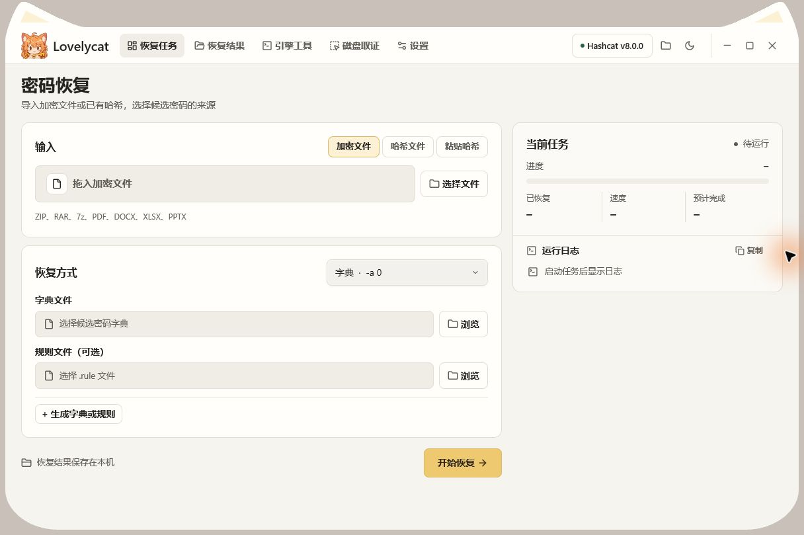

<div align="center">
  
  <h1>Lovelycat</h1>
  <p><strong>Windows 上的 Hashcat 图形界面与磁盘取证工作台</strong></p>
  <p><code>Windows x64</code> &nbsp;·&nbsp; <code>Rust + GPUI</code></p>
  <p>
    <a href="#快速开始">快速开始</a> &nbsp;·&nbsp;
    <a href="#密码恢复">密码恢复</a> &nbsp;·&nbsp;
    <a href="#磁盘取证">磁盘取证</a> &nbsp;·&nbsp;
    <a href="#引擎工具">引擎工具</a>
  </p>
</div>

<p align="center">
  <picture>
    <source media="(prefers-color-scheme: dark)" srcset="assets/preview/workbench-dark.jpg">
    <source media="(prefers-color-scheme: light)" srcset="assets/preview/workbench-light.jpg">
    
  </picture>
</p>

## 快速开始

在 Windows x64 上安装 Rust MSVC 工具链、Visual Studio C++ 构建工具和 Windows SDK。项目已在 Rust 1.93.1 上验证。[Rust MSVC 构建文档](https://doc.rust-lang.org/rustc/platform-support/windows-msvc.html)

```powershell
git clone https://github.com/LovelyTeams/Lovelycat.git
Set-Location Lovelycat
cargo build --release --locked
.\target\release\lovelycat.exe
```

| 开始使用 | 在 Lovelycat 中操作 |
| --- | --- |
| 恢复文件密码 | 在「设置」连接已有的 `hashcat.exe`，或从「下载资源」安装 Hashcat 8.0.0。「检测设备」显示引擎识别到的显卡和驱动 |
| 解密磁盘镜像 | 在「磁盘取证」点击「安装组件」。程序会校验下载包，安装后可离线处理镜像 |

## 密码恢复

1. 在「恢复任务」中拖入加密文件，或导入哈希文件、粘贴已有哈希。直接导入加密文件时，Lovelycat 会识别可用的 Hashcat 模式。
2. 选择字典、掩码、组合或混合等候选模式。常用掩码可通过模板填写，字典模式可以生成并预览 UTF-8 字典和 `.rule` 文件。
3. 点击「开始恢复」查看进度和运行日志。找到的密码会立即显示在「当前任务 → 已恢复密码」，历史记录可在「恢复结果」查看。

### 可直接导入的加密文件

| 文件类型 | 支持的加密形式 | Hashcat 模式 |
| --- | --- | --- |
| ZIP | WinZip AES、ZipCrypto 存储或 Deflate 成员 | 13600、17210、17200 |
| 7z | AES 加密的文件头，或 AES 配合 LZMA、LZMA2 或存储成员 | 11600 |
| RAR | RAR5 文件或文件头加密、RAR3 文件头加密 | 13000、12500 |
| DOCX、XLSX、PPTX 及常见 OOXML 变体 | Standard AES-128 或常见 Agile SHA-1、SHA-512 打开密码 | 9400、9500、9600 |
| PDF | Standard Security Handler 打开密码，覆盖常见 RC4 和 AES R2–R6 组合 | 10400、10500、10600、10700 |

<details>
<summary>文件解析范围</summary>

- Office 的工作表保护和限制编辑属于其他保护机制。已有引擎支持的哈希时，可以直接导入哈希。
- ZIP 和 7z 取一个可用的校验成员或数据块。归档内有多组密码时，恢复结果对应选中的校验数据。
- WinZip AES 和 7z 密文块需要小于 8 MiB，ZipCrypto 校验成员上限为 320 KiB，PDF 解析上限为 128 MiB。
- 其他格式可用「哈希文件」或「粘贴哈希」导入当前引擎支持的哈希。[Hashcat 8.0.0 模式示例](https://github.com/hashcat/hashcat/blob/v8.0.0/docs/hashcat-example-hashes.md)

</details>

## 磁盘取证

以只读方式导入 RAW 整盘或卷镜像（如 `.dd`、`.img`）、分段 EWF v1，或独立的固定与动态 VHD、VHDX。EWF 镜像从首段 `.E01` 导入，各分段放在同一目录。差分链可以先合并为独立副本。

| 加密卷 | 可用凭据 |
| --- | --- |
| BitLocker | 卷密码、48 位数字恢复密钥或对应的 `.BEK` 文件，取决于卷上的保护器 |
| LUKS1、LUKS2 | 卷密码或二进制密钥文件 |

导入后，程序显示 GPT 或 MBR 分区及其字节偏移。选择卷并输入已知凭据，点击「解密并导出」即可保存新的 RAW 卷镜像，并复制包含源卷偏移、导出长度和 SHA-256 的取证记录。镜像读取与卷解密使用 Dissect。[Dissect 加密卷 API](https://github.com/fox-it/dissect.fve) · [镜像格式](https://docs.dissect.tools/en/latest/supported-targets.html)

## 引擎工具

「引擎工具」从当前 Hashcat 版本加载哈希类型、候选模式和原生命令选项。可以按编号、名称或分类查找哈希类型，通过「用于任务」带回恢复表单，也能查看版本、检测设备和运行基准测试。

执行原生命令时，每行填写一个实参。带空格的路径可原样输入，相对路径以 Hashcat 安装目录为基准。「运行并导出」会保存完整标准输出，「交互终端」提供 Hashcat 原生键盘操作。[Hashcat 8.0.0 命令参考](https://github.com/hashcat/hashcat/blob/v8.0.0/docs/hashcat-help.md)

## 本地数据与外观

| 设置 | 默认位置或可选项 |
| --- | --- |
| 恢复结果目录 | `%LOCALAPPDATA%\Lovelycat\jobs`。每个任务将结果写入 `recovered.txt`，更换目录后仍可查看历史任务 |
| 下载资源 | Hashcat 8.0.0、RockYou 和取证组件保存在 `%LOCALAPPDATA%\Lovelycat\resources`。下载包通过 SHA-256 校验后解压 |
| 主题 | 暖白、薄荷、炭黑、午夜蓝 |
| 窗口轮廓 | 猫咪头、斜切、圆角、标准窗口。最大化时铺满屏幕，还原后恢复所选轮廓 |

## 验证

```powershell
cargo fmt -- --check
cargo test --release --locked
```

<details>
<summary>运行磁盘取证集成测试</summary>

测试会在临时目录安装独立运行环境，并使用公开的 LUKS2 测试镜像验证导出、取消和输出文件保护。

```powershell
cargo test --release --locked exports_volume_and_keeps_sources_and_existing_files_intact -- --ignored
```

</details>
